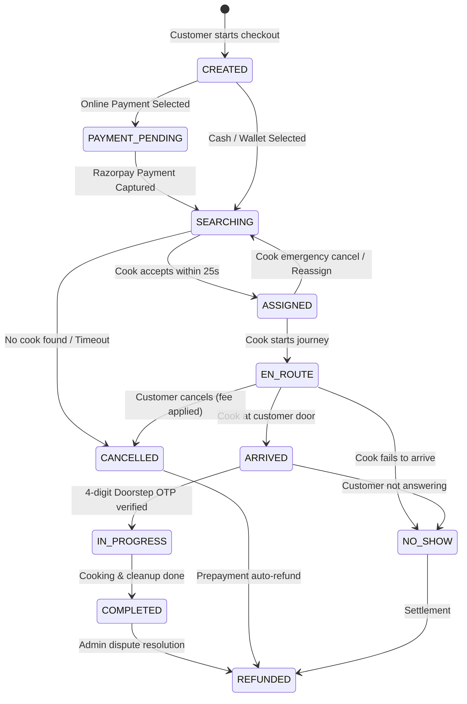

# Cookii — System Architecture & Monolith Decoupling Guide

**Platform:** Production-grade, on-demand home cook booking platform for Bengaluru, India  
**Architecture:** Modular Monolith with Event-Driven Decoupling  
**Target Scalability:** 10,000+ daily bookings across Bengaluru zones with microservice-ready extraction boundaries

---

## 1. High-Level System Architecture

```mermaid
flowchart TB
    subgraph Clients["Client Layer"]
        CA[Customer App - Flutter]
        CK[Cook Partner App - Flutter]
        AD[Admin Web Portal - Next.js]
    end

    subgraph Gateway["API Gateway / Ingress"]
        CORS[CORS & Helmet]
        RATELIMIT[Rate Limiter]
        SWAGGER[Swagger /docs Explorer]
    end

    subgraph Monolith["Cookii Backend Monolith (NestJS Strict Mode)"]
        AUTH[Auth Module - Phone OTP & JWT]
        USERS[Users & Address Module]
        COOKS[Cooks & Verification Module]
        SERVICES[Services & Bengaluru Cuisines]
        PRICING[Pricing Engine - Dynamic Zones]
        BOOKINGS[Bookings & State Machine]
        MATCHING[Matching Radar & BullMQ Timeout]
        PAYMENTS[Payments - Razorpay & Wallet Ledger]
        CHAT[Masked Chat & Emergency SOS]
        NOTIF[Notifications - FCM & SMS]
        ADMIN[Admin Ops & Bengaluru Live Map]
    end

    subgraph MessageBroker["Async Event Bus & Queue"]
        EMITTER[NestJS EventEmitter (In-Process)]
        BULLMQ[BullMQ + Redis 7.2 (Distributed)]
    end

    subgraph DataStore["Data & Persistence Layer"]
        MONGO[(MongoDB 7.0 / Atlas Free Tier)]
        REDIS[(Redis / Upstash Free Tier)]
        CLOUDINARY[(Cloudinary Media CDN)]
    end

    CA --> Gateway
    CK --> Gateway
    AD --> Gateway
    Gateway --> Monolith

    BOOKINGS -.->|Events: booking.created| EMITTER
    MATCHING -.->|Dispatch 25s timeout job| BULLMQ
    BULLMQ -.->|Job trigger / escalation| MATCHING
    PAYMENTS -.->|Razorpay Webhook| BOOKINGS

    Monolith --> MONGO
    Monolith --> REDIS
    COOKS --> CLOUDINARY
```

---

## 2. Module Boundaries & Microservice Extraction Strategy

To ensure zero-rewrite microservice extraction in future AWS migration, strict rules govern inter-module communication:
1. **No direct database queries across modules:** `BookingsModule` NEVER imports Mongoose `UserModel` or `CookProfileModel`. It interacts exclusively via exported service interfaces (e.g. `CooksService.getAvailability()`) or domain events.
2. **Domain Events over Direct Coupling:**
   - `booking.created` -> Listened to by `MatchingModule` to start radar.
   - `cook.assigned` -> Listened to by `NotificationsModule` to send FCM push to customer.
   - `service.completed` -> Listened to by `PaymentsModule` to trigger wallet credit to cook partner.
   - `sos.triggered` -> Listened to by `AdminModule` to sound alarm on the ops dispatch map.
3. **Queue-Based Timeouts:**
   - The 25-second cook acceptance window uses BullMQ with Redis delayed jobs:
     `jobQueue.add('offer-timeout', { offerId, bookingId }, { delay: 25000 })`

---

## 3. Booking State Machine Transitions



---

## 4. Runbook: How to Run and Test Locally

### 4.1 Prerequisites
- Node.js `v22+`
- pnpm `v10+` (`npm install -g pnpm`)
- Docker Desktop or local MongoDB (`mongodb://localhost:27017`) + Redis (`redis://localhost:6379`)

### 4.2 Installation & Build
```bash
# 1. Install all dependencies across monorepo
pnpm install

# 2. Build shared packages
pnpm --filter @cookii/shared-types run build
pnpm --filter @cookii/design-tokens run build

# 3. Start local infra (MongoDB + Redis)
docker-compose up -d mongodb redis
```

### 4.3 Running Services
```bash
# Start NestJS Backend in watch mode
pnpm dev:backend
# Access API at: http://localhost:4000/api/v1
# Interactive Swagger Documentation: http://localhost:4000/docs

# Start Admin Dashboard
pnpm dev:admin
# Access Admin Portal at: http://localhost:3000
```

### 4.4 Verification & Testing
```bash
# Backend unit & integration tests
pnpm test:backend

# Linter check
pnpm lint
```

