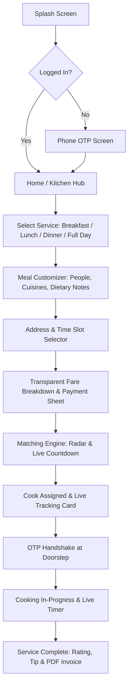
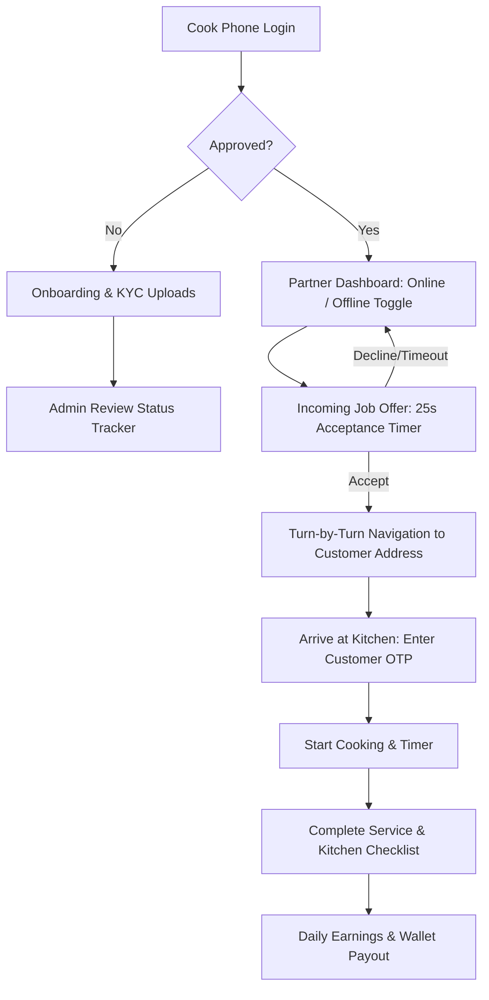

# Cookii — Design System & UI/UX Specification

**Brand Identity:** Warm, Appetizing, Trustworthy, Calm  
**Target Market:** Bengaluru, Karnataka, India  
**Reference Design Benchmark:** Snabbit / Uber / Slice (zero rough edges, sticky CTAs, one-thumb reach, spring motion)

---

## 1. Visual Language & Brand Tokens

### 1.1 Color Palette Philosophy
Cookii deliberately avoids cold corporate blues, generic AI purple gradients, and aggressive discount neon yellows.  
Instead, the palette is rooted in authentic kitchen culinary cues:
- **Ember Terracotta (`#E05315` / `#F97316` in Dark):** The focal brand color evokes warm clay pots, simmering sambar, freshly tempered mustard seeds, and tawa warmth.
- **Ivory Cream Canvas (`#FAF7F2` in Light):** Replaces clinical blinding white `#FFFFFF` with warm cream that feels calm and homelike.
- **Charred Espresso Typography (`#1E1B18`):** Organic, deep, high-contrast readability without the starkness of pure `#000000`.
- **Coriander Fresh Green (`#15803D` / `#22C55E`):** Trust, verified cook badges, hygiene certification, and organic freshness.

```
+---------------------------------------------------------------------------------+
| BRAND PRIMARY:  [#E05315] Warm Terracotta Saffron (Primary Actions & Branding) |
| ACCENT FRESH:   [#15803D] Coriander Emerald (Verified Badges, Success, Fresh)   |
| SURFACE CANVAS: [#FAF7F2] Warm Cream Canvas (Light Theme Body Background)       |
| SURFACE CARD:   [#FFFFFF] Pure Milk Card (Cards & Floating Sheets)              |
| TEXT PRIMARY:   [#1E1B18] Charred Espresso (Body & Headings)                    |
| TEXT MUTED:     [#635D56] Warm Slate (Supporting Meta Information)              |
+---------------------------------------------------------------------------------+
```

### 1.2 Spacing & Layout Grid (4pt / 8pt Scale)
All layout margins, paddings, and card gaps snap strictly to multiples of 4 and 8:
- `2xs` (2px): Micro badges, stroke offsets
- `xs`  (4px): Icon-to-text inline gap
- `sm`  (8px): Compact item spacing, pill padding
- `md`  (12px): Form input inner vertical padding, card internal separation
- `lg`  (16px): Standard screen horizontal gutter, card internal padding
- `xl`  (20px): Section vertical spacing
- `2xl` (24px): Bottom sheet top padding, modal headers
- `3xl` (32px): Hero section gaps, onboarding illustration margins
- `4xl` (40px): Bottom spacer for sticky CTAs
- `5xl` (48px): Minimum touch target height for buttons / tappable list rows
- `6xl` (64px): Empty state vertical clearance

### 1.3 Typography System
- **Display & Headings:** `Fraunces` (Editorial Serif with variable weight) & `Outfit` (Geometric Warmth). Used sparingly for hero headers ("Craving hot filter coffee & home dosas in Koramangala?").
- **Interface & Body:** `Plus Jakarta Sans`. High legibility on small phone screens (360dp width) with crisp apertures and balanced numerals for pricing.
- **Monospace / OTP / Codes:** `JetBrains Mono` for OTP digits, tracking IDs, and booking codes.

| Token | Size | Line Height | Weight | Usage |
| :--- | :--- | :--- | :--- | :--- |
| `displayLg` | 32px | 40px | 700 (Bold) | Welcome heroes, big invoice totals |
| `displayMd` | 28px | 36px | 700 (Bold) | Service headers, cook profile name |
| `titleLg` | 22px | 28px | 600 (SemiBold) | Sheet titles, section headers |
| `titleMd` | 18px | 24px | 600 (SemiBold) | Card titles, active slot badge |
| `titleSm` | 16px | 22px | 600 (SemiBold) | Cook name on card, sticky bar summary |
| `bodyLg` | 16px | 24px | 400 (Regular) | Long descriptions, instructions |
| `bodyMd` | 14px | 20px | 400 (Regular) | Standard UI labels, inputs, table cells |
| `bodySm` | 12px | 16px | 400 (Regular) | Timestamps, dietary footnotes |
| `caption` | 11px | 14px | 500 (Medium) | Pill tags, status badges, GST note |

### 1.4 Elevation, Shadows & Corner Radii
- **Corner Radii:**
  - Micro (`4px`): Badges, OTP digit boxes
  - Small (`8px`): Checkboxes, small chips, secondary buttons
  - Medium (`12px`): Input fields, meal selection tiles
  - Large (`16px`): Floating cards, cook preview tiles
  - X-Large (`24px`): Bottom sheet top corners (Snabbit/Uber curve)
  - Full (`9999px`): Pill buttons, avatar rings, filter chips
- **Shadows:** Tinted with warm neutral tone `rgba(30, 27, 24, ...)` rather than muddy gray `rgba(0, 0, 0, ...)`.
  - `shadow-card`: Subtle card resting elevation
  - `shadow-floating`: Live cook tracking card floating above the MapLibre map
  - `shadow-modal`: Full screen bottom sheet overlay

---

## 2. Interaction Paradigms & Mobile Ergonomics

### 2.1 One-Thumb Ergonomics (Bottom-Anchored)
- **Primary Sticky CTA:** Fixed at the bottom of the viewport with safe area inset padding (`padding-bottom: max(16px, env(safe-area-inset-bottom))`). The user never reaches for top-right headers to confirm a slot or pay.
- **Bottom Sheet Modal Workflows:** 
  - Selecting cuisine preferences
  - Picking address from saved pins
  - Date & slot picker
  - Live cook tracking card (peek at 200dp, expand to 65% on drag)
- **Top Bar Simplicity:** Back button, area name pill (e.g. `📍 4th Block, Koramangala ▾`), and notification bell.

### 2.2 Micro-Interactions & Haptics
- **Haptic Feedback:**
  - Selection Click (Light): Tapping a meal slot, toggling vegetarian/non-vegetarian
  - Impact Medium: Bottom sheet snapping into place, coupon applied
  - Success Feedback: Cook accepted booking, OTP validated
  - Warning/Error: No cook available in 5km, invalid OTP
- **Spring Animations:** Snappy sheet opening with zero bounce overshoot: `cubic-bezier(0.16, 1, 0.3, 1)`.
- **Skeleton Shimmers:** Replaces spinner wheels everywhere. Pulsing skeleton mimics the exact height and shape of cook cards, meal tiles, and booking items.
- **Reduced Motion:** If `prefers-reduced-motion` is enabled, all animations fall back to instant alpha crossfades (100ms).

---

## 3. Comprehensive State Matrix

Every screen must explicitly handle all 5 states:
1. **Content State:** Real, rich Bengaluru data (e.g., "Sita Lakshmi • 4.9 ★ • 820 meals cooked • Speaks Kannada, Hindi, English • Specialist: Jolada Roti, Bisi Bele Bath").
2. **Empty State:** Friendly illustration, clear explanation, and primary action button (e.g. "No saved addresses yet. Add your kitchen location to see cooks nearby.").
3. **Loading State:** Skeleton shimmer matching the exact layout.
4. **Error State:** Human-first message (e.g., "Couldn't reach the server. Your kitchen is safe, let's retry.") with a single "Retry" button.
5. **Offline State:** Banner pinned under top bar: "You're offline. Reconnecting..." with cached recent bookings still visible.
6. **Permission-Denied State:** Contextual explanation for Location / Notifications / Camera permissions with a "Open Settings" deep-link button.

---

## 4. Screen Inventory & Core User Journeys

### 4.1 Customer App Flow (Mobile)


1. **Splash & Welcome:** Warm branding, immediate value proposition ("Fresh home-cooked meals by verified Bengaluru cooks").
2. **Phone OTP Screen:** +91 prefix locked, 6-digit auto-advancing input, auto-fill listener, resend timer countdown.
3. **Kitchen Hub (Home):**
   - Active address picker bar at top (`📍 Indiranagar 100ft Rd`)
   - Quick "Book Now (Next 45 mins)" vs "Schedule for Later"
   - Service cards with realistic imagery:
     - Morning Breakfast (Dosas, Idlis, Poha, Upma)
     - Afternoon Lunch (Rice, Roti, Dal, Sabzi, Curd)
     - Dinner (Light Rotis, Curries, Khichdi)
     - Full Day Cook (3 meals + kitchen cleanup)
   - "Top Rated Cooks in Your Neighborhood" horizontal carousel
4. **Meal & Preference Customizer:**
   - Person counter stepper (`1`, `2`, `4`, `6+`)
   - Cuisine pills: `South Indian`, `North Indian`, `Karnataka Special`, `Bengali`, `Jain (No Onion/Garlic)`
   - Dietary checkboxes: `Vegetarian Only`, `Eggitarian`, `Include Non-Veg Prep`, `Less Oil & Spice`
   - Spice level selector: Mild / Medium / Traditional
5. **Slot & Address Picker:**
   - Interactive MapLibre pin with reverse geocoding
   - Saved tags: `Home`, `Work`, `Parents`
   - Slot chips: Morning (7:00 AM, 7:30 AM, 8:00 AM, 8:30 AM), Lunch (12:00 PM, 12:45 PM), Dinner (7:30 PM, 8:15 PM)
6. **Transparent Price & Checkout Sheet:**
   - Clean breakdown: Base fare + Per-person add-on + GST (5%) - Coupon discount
   - Cook earnings transparency: "Cook receives ₹420 of this booking"
   - Payment choices: UPI (GPay/PhonePe/Paytm direct intent), Cards, Cookii Wallet, Cash after cooking
7. **Live Radar / Matching Screen:**
   - Soft pulsing radar animation over Koramangala/HSR map
   - "Notifying 3 verified cooks within 3.2 km..."
   - Cancel button with 60-second grace window
8. **Live En-Route & Doorstep OTP Screen:**
   - Floating card with cook photo, phone masking button, ETA (e.g. "Arriving in 14 mins")
   - Masked Chat button
   - 4-digit start OTP prominent for customer to give to cook
   - SOS Emergency Button (one-tap trigger to ops + emergency contact)
9. **In-Progress Cooking View:**
   - Live timer showing elapsed and estimated cooking time
   - Grocery check items list
10. **Rating & Tipping:**
    - 5-star rating with chips ("Punctual", "Super Hygienic", "Tasted like Mom's food", "Cleaned Kitchen After")
    - Quick tip buttons: ₹30, ₹50, ₹100, Custom
    - Immediate one-click invoice download

---

### 4.2 Cook Partner App Flow (Mobile)


1. **Cook Onboarding & KYC:**
   - Full name, emergency contact, languages spoken (`ಕನ್ನಡ`, `हिंदी`, `English`, `తెలుగు`, `தமிழ்`)
   - Cuisines master list & photo uploads of specialty dishes
   - Document verification: Aadhaar Card (front & back), Bank Account / UPI ID for daily payouts, Police Verification certificate upload
2. **Approval Status Screen:** Clear progress tracking (`Application Submitted` -> `Document Verification` -> `Background Check` -> `Ready to Cook`).
3. **Partner Dashboard (Online / Offline):**
   - Prominent toggle switch: `Go Online to Receive Bookings`
   - Today's earnings counter: `₹1,850 earned today (4 jobs)`
   - Acceptance rate & rating badge (`4.92 ★`)
   - Hotspot zones map showing high demand areas (e.g. `HSR Sector 2 high demand`)
4. **Incoming Job Offer Modal (25-second countdown):**
   - Loud distinctive chime + haptic vibration
   - Guaranteed earnings badge: `₹450 payout`
   - Customer distance: `1.8 km away (8 mins ride)`
   - Meal details: `Lunch for 3 people • Karnataka Style (Ragi Mudde, Sambar)`
   - Slide to accept or tap to decline
5. **Active Service Screen:**
   - One-click navigation via MapLibre / Google Maps
   - Call customer (masked virtual number)
   - "Enter Start OTP" modal
   - "Service in Progress" timer with Emergency SOS
   - "Mark as Cooked & Cleaned" completion button
6. **Earnings & Payout Ledger:**
   - Double-entry wallet breakdown
   - Daily automated UPI payout button

---

### 4.3 Admin Operations Dashboard (Web - Next.js)
1. **Live Ops Map (Bengaluru Metro):**
   - Real-time heatmaps of active cooks in Koramangala, Indiranagar, HSR, Whitefield, Bellandur, JP Nagar
   - Live booking markers color-coded by state (`Searching`, `En Route`, `Cooking`)
   - SOS alert flashing banner with direct audio ping to operations team
2. **Cook Verification Queue:**
   - Split-screen document inspection: Aadhaar OCR preview, Police clearance, profile photo
   - Quick action keys: `Approve [A]`, `Reject [R]`, `Request Re-upload [U]` with pre-filled SMS templates
3. **Dynamic Pricing & Zone Manager:**
   - Base rates per service type
   - Peak hours multipliers (e.g. 7:30 AM - 9:30 AM breakfast surge)
   - Payout share percentage configuration (e.g. 80% to cook, 20% platform fee)
4. **Booking Lifecycle Manager:** Full timeline inspection with state override, emergency reassignment, and refund trigger.
5. **Dispute & Support Resolution:** Customer ratings below 3 stars automatically open a triage ticket.

---

## 5. Localisation & Regional Strings

Cookii is built first for Bengaluru, requiring native language support for English, Kannada (`kn-IN`), and Hindi (`hi-IN`).

| Key | English (`en`) | Kannada (`kn`) | Hindi (`hi`) |
| :--- | :--- | :--- | :--- |
| `app_name` | Cookii | ಕೂಕೀ | कूकी |
| `book_now_cta` | Book a Cook Now | ಈಗಲೇ ಅಡುಗೆಯವರನ್ನು ಬುಕ್ ಮಾಡಿ | अभी रसोइया बुक करें |
| `service_breakfast` | Morning Breakfast | ಬೆಳಗಿನ ಉಪಹಾರ | सुबह का नाश्ता |
| `service_lunch` | Afternoon Lunch | ಮಧ್ಯಾಹ್ನದ ಊಟ | दोपहर का भोजन |
| `service_dinner` | Night Dinner | ರಾತ್ರಿಯ ಊಟ | रात का खाना |
| `service_fullday` | Full Day Cook | ಪೂರ್ಣ ದಿನದ ಅಡುಗೆ | पूरे दिन का रसोइया |
| `cook_verified_badge`| Background Verified | ಹಿನ್ನೆಲೆ ಪರಿಶೀಲಿಸಲಾಗಿದೆ | पृष्ठभूमि सत्यापित |
| `start_otp_label` | Share this OTP with cook | ಈ OTP ಅನ್ನು ಅಡುಗೆಯವರೊಂದಿಗೆ ಹಂಚಿಕೊಳ್ಳಿ | यह OTP रसोइये को बताएं |
| `sos_emergency` | Emergency SOS | ತುರ್ತು ಎಸ್‌ಒಎಸ್ | आपातकालीन एसओएस |

---

## 6. Accessibility & Performance Benchmarks
- **Target Touch Targets:** Minimum `48dp x 48dp` on all interactive touchpoints.
- **Contrast Ratio:** WCAG 2.1 AA compliant. Text-to-background contrast minimum `4.8:1` on body text and `3.1:1` on large display headers.
- **Cold Start Time:** `< 1.8 seconds` on budget Android devices (Redmi / Realme 4GB RAM benchmark).
- **Bundle Optimization:** Tree-shaking SVGs, lazy-loaded route chunks, and WebP compressed food imagery.

